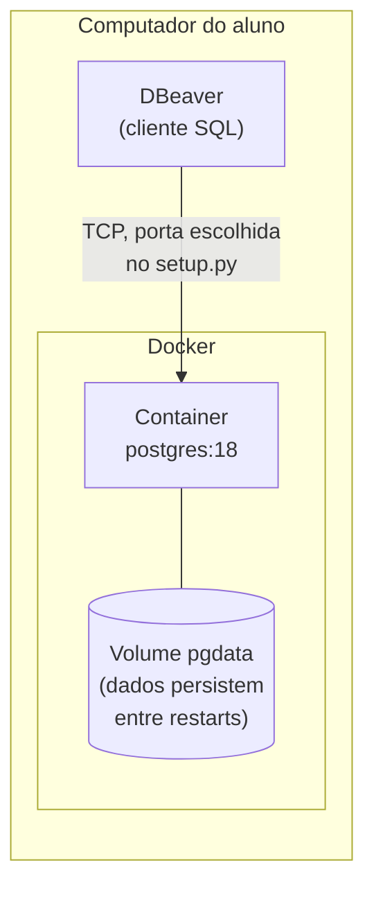
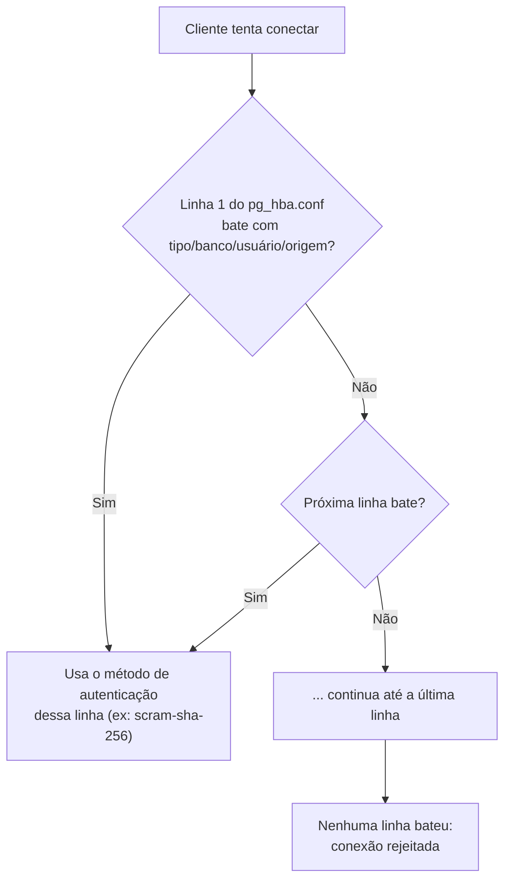
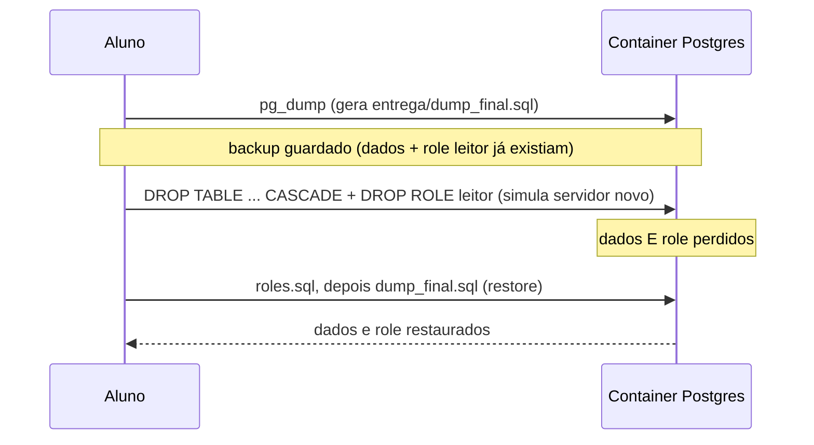

# Laboratório — Administração de PostgreSQL

## Orientações iniciais (leia antes de começar)

- **Objetivo**: praticar administração de PostgreSQL — parâmetros de
  configuração, autenticação, roles/privilégios e backup/restore lógico.
  Não é uma atividade sobre Linux/Docker: o container é só o "servidor"
  onde você pratica, não o foco da avaliação.
- **Ambiente individual**: cada aluno sobe o próprio container, na própria
  máquina. Nada é compartilhado entre colegas nem depende de rede/servidor
  central — pode fazer de casa ou do laboratório.
- **Pode errar e resetar**: `docker compose down -v` apaga tudo e volta ao
  zero. Use sem medo pra testar — é mais barato resetar o container do que
  tentar desfazer um erro manualmente.
- **O que entregar e quando**: ao final da seção "Entrega" tem a lista
  exata de arquivos. *(Ajuste aqui o prazo e o canal de envio — Moodle,
  por exemplo — antes de repassar aos alunos.)*
- **Como será avaliado**: a seção "Critério de avaliação" logo abaixo mostra
  o peso de cada item. Rode `python check_lab.py` quando quiser conferir sua
  nota estimada antes de entregar — ele não envia nada, é só pra você se
  autoavaliar.
- **Dúvidas durante a aula**: *(ajuste aqui o canal — ex.: levantar a mão,
  fórum do Moodle, etc.)*

## Critério de avaliação

A nota (0 a 10) é a soma dos pesos dos itens que passam, verificados
automaticamente por `check_lab.py` (sua autoavaliação) e `corrige_lab.py`
(correção oficial do professor, numa cópia isolada do seu ambiente).

| Item avaliado | Peso | O que precisa ser verdade |
|---|---|---|
| `max_connections` ajustado | 1.0 | valor diferente do padrão, conforme pedido na etapa 3 |
| `work_mem` ajustado | 1.0 | valor diferente do padrão, conforme pedido na etapa 3 |
| `pg_hba.conf` sem regras `trust` | 1.5 | nenhuma linha do `pg_hba.conf` ativo usa `trust` (etapa 4) |
| Role `leitor` existe | 1.5 | a role foi recriada após o restore (etapa 5 + `roles.sql`) |
| Tabela `cliente` restaurada | 1.67 | existe e tem os dados esperados após o restore (etapa 7) |
| Tabela `produto` restaurada | 1.67 | idem |
| Tabela `pedido` restaurada | 1.66 | idem |
| **Total** | **10.0** | |

Conexão com o banco é pré-requisito, não item avaliado: se o `check_lab.py`
nem conseguir conectar, a nota fica 0 independente dos outros itens (não há
como verificar o resto sem conseguir entrar no banco).

## Visão geral e tempo estimado

| Etapa | Conceito | Tempo estimado |
|---|---|---|
| 1. Subir o ambiente | Containers como "VM leve" | 10 min |
| 2. Conectar via DBeaver | Arquitetura cliente-servidor | 10 min |
| 3. Parâmetros de configuração | Memória e conexões do servidor | 20 min |
| 4. Autenticação (`pg_hba.conf`) | Controle de acesso | 15 min |
| 5. Roles e privilégios | Princípio do menor privilégio | 15 min |
| 6. Backup lógico | `pg_dump` | 10 min |
| 7. Restore | Recuperação de desastre | 15 min |
| **Total** | | **~95 min** |

Turmas sem experiência prévia com Docker/DBeaver tendem a gastar uns 15-20 min extras
só nas etapas 1-2 (instalação, primeira conexão). Depois disso o ritmo acelera.

## Pré-requisitos
- Docker Desktop (Windows/macOS) ou Docker Engine + Compose (Linux), instalado e rodando.
  No Windows, o Docker Desktop exige o backend WSL2 (ele mesmo guia a instalação disso).
- [DBeaver](https://dbeaver.io/) instalado (Community Edition é suficiente).
- Python 3 (só pra rodar `setup.py` e `check_lab.py` — já vem instalado no macOS/Linux;
  no Windows, instale do [python.org](https://python.org) marcando "Add to PATH").

Se a máquina do laboratório ainda não tem nada disso configurado, veja
[`preparacao-maquinas-lab.md`](preparacao-maquinas-lab.md) — checklist
separado pra quem prepara as máquinas antes da aula (instalar Docker,
permissões, pré-baixar a imagem pra não depender da rede da sala no dia).

Tudo neste roteiro (comandos `docker ...`) funciona igual em Windows (PowerShell ou
cmd), Linux e macOS — nenhum comando depende de bash.

## Arquitetura do ambiente

Cada aluno sobe, na própria máquina, um container com PostgreSQL — nada é
compartilhado entre alunos nem depende de um servidor central. O DBeaver conversa
com esse container exatamente como conversaria com um servidor Postgres "de verdade"
em produção: por rede, numa porta TCP.



Por que isso importa: o que você aprende aqui sobre parâmetro, autenticação e
backup é o mesmo conceito de um Postgres rodando numa VM, num servidor bare-metal
ou num RDS da AWS — só a forma de acessar o arquivo de configuração muda (aqui é
`docker cp`/`docker exec`; numa VM seria SSH).

## 1. Subir o ambiente

```bash
python3 setup.py   # Linux / macOS
python setup.py    # Windows
```

O script pergunta a porta (padrão `5433`, pra não conflitar com um Postgres que já exista
no seu computador na `5432`), usuário, senha e nome do banco. Ao final ele já sobe o
container e mostra os dados de conexão. Funciona igual em Windows, Linux e macOS.

**Saída esperada** (os valores entre colchetes são o padrão — só dar Enter aceita;
digite outro valor se quiser mudar):

```text
== Laboratório de Administração PostgreSQL ==

Em qual porta expor o Postgres no seu computador? [5433]: 5434
Usuário do banco [aluno]: aluno
Senha do banco [aluno123]: aluno123
Nome do banco [loja]: loja

Configuração salva em .env. Subindo o container...
 Network lab-postgresql-admin_default  Created
 Volume lab-postgresql-admin_pgdata  Created
 Container lab_postgres  Created
 Container lab_postgres  Started

Pronto! Conecte no DBeaver com:
  Host:     localhost
  Porta:    5434
  Database: loja
  Usuário:  aluno
  Senha:    aluno123

Driver: PostgreSQL (o DBeaver detecta e baixa o driver na primeira conexão).
```

Se a porta escolhida já estiver ocupada, o script avisa e pergunta de novo —
não precisa reiniciar nada, só escolher outra porta (ex. `5434`, `5500`...).

Pra parar: `docker compose stop`. Pra resetar tudo do zero (apaga os dados): `docker compose down -v`.

## 2. Conectar via DBeaver

**Conceito**: arquitetura cliente-servidor. O DBeaver é só um *cliente* — toda a
lógica (processar SQL, gerenciar memória, controlar acesso) roda do lado do
*servidor* (o container). É esse servidor que você vai administrar no resto do
laboratório.

**Como criar a conexão**:

1. Abra o DBeaver → `Database` → `New Database Connection` (ou o ícone de
   tomada com `+` na barra de ferramentas).
2. Na lista de drivers, escolha **PostgreSQL** → `Next`.
3. Preencha os campos da aba "Main" com os dados impressos pelo `setup.py`:

   | Campo | Valor |
   |---|---|
   | Host | `localhost` |
   | Port | a porta que você escolheu (ex. `5434`) |
   | Database | `loja` (ou o nome que você escolheu) |
   | Username | `aluno` (ou o que você escolheu) |
   | Password | `aluno123` (ou o que você escolheu) — marque "Save password" |

4. `Test Connection...` — na primeira vez o DBeaver oferece baixar o driver
   JDBC do PostgreSQL automaticamente; aceite. Deve aparecer "Connected".
5. `Finish`. A conexão aparece na árvore à esquerda — expanda até
   `Databases → loja → Schemas → public → Tables` e confira `cliente`,
   `produto` e `pedido` já carregadas.

> *(Espaço reservado pra um print real da tela "Connection Settings" do
> DBeaver com os campos acima preenchidos — tire um na sua máquina e troque
> este parágrafo por ``.)*

## 3. Parâmetros de configuração

**Conceito**: o comportamento do servidor (quanta memória usar, quantas conexões
aceitar, o que registrar em log) é controlado por `postgresql.conf` — um arquivo de
texto simples, não um banco de configuração. Alguns dos parâmetros mais relevantes
pra administração:

| Parâmetro | O que controla |
|---|---|
| `max_connections` | Quantas conexões simultâneas o servidor aceita (cada uma consome memória e um processo) |
| `shared_buffers` | Memória reservada pro cache de páginas de dados — o parâmetro de performance mais citado do Postgres |
| `work_mem` | Memória que *cada operação* de ordenação/hash pode usar antes de gravar em disco temporário |
| `log_statement` | Quais comandos SQL vão pro log (útil pra auditoria e debug) |

No PostgreSQL 18 (mudou em relação a versões anteriores), o arquivo de configuração
roda dentro do container em `/var/lib/postgresql/18/docker/postgresql.conf`.

1. Copie o arquivo pra fora pra poder editar:
   ```bash
   docker cp lab_postgres:/var/lib/postgresql/18/docker/postgresql.conf entrega/postgresql.conf
   ```
2. Edite `entrega/postgresql.conf` e ajuste (pelo menos):
   - `max_connections`
   - `shared_buffers`
   - `work_mem`
   - `log_statement` (ex.: `'all'`, pra ver todo comando executado no log)
3. Copie de volta e reinicie pra aplicar:
   ```bash
   docker cp entrega/postgresql.conf lab_postgres:/var/lib/postgresql/18/docker/postgresql.conf
   docker compose restart db
   ```
4. Confirme a mudança no DBeaver ou via `psql`:
   ```sql
   SHOW max_connections;
   SHOW work_mem;
   ```

## 4. Autenticação (`pg_hba.conf`)

**Conceito**: o Postgres separa duas perguntas diferentes — "você tem permissão
pra fazer X?" (roles/privilégios, próxima etapa) e "você é mesmo quem diz ser?"
(autenticação, aqui). O `pg_hba.conf` é lido **linha por linha, de cima pra baixo**,
e a primeira linha que bater com tipo de conexão + banco + usuário + endereço de
origem decide o método de autenticação usado — as linhas depois dela nem são olhadas.



Mesma mecânica do passo anterior, com `pg_hba.conf`:

```bash
docker cp lab_postgres:/var/lib/postgresql/18/docker/pg_hba.conf entrega/pg_hba.conf
```

No arquivo copiado, troque **todas** as linhas com método `trust` para
`scram-sha-256` (são as linhas `local`/`host` para `all`/`127.0.0.1`/`::1` —
a conexão publicada no host, pela porta do DBeaver, já usa `scram-sha-256`
por padrão numa regra catch-all; o que falta trocar é o acesso local/direto
ao container). Copie de volta + `docker compose restart db`.

Teste: `docker compose exec db psql -U aluno -d loja` deve passar a **pedir
senha** (antes não pedia, por causa do `trust`). Teste reconectando também
no DBeaver — continua funcionando, porque a senha já estava certa lá.

## 5. Roles e privilégios

**Conceito**: depois que o Postgres confirma *quem* você é, ele decide *o que* você
pode fazer — isso é controlado por roles e `GRANT`/`REVOKE`. A boa prática de
administração é o **princípio do menor privilégio**: toda role deve ter só o acesso
estritamente necessário pra sua função, nunca mais.

Via DBeaver (SQL Editor) ou `psql`:

```sql
CREATE ROLE leitor LOGIN PASSWORD 'leitor123';
GRANT SELECT ON produto, cliente TO leitor;
```

Conecte uma nova conexão no DBeaver com o usuário `leitor` e confirme que:
- consegue fazer `SELECT` em `produto`;
- **não** consegue fazer `INSERT`/`UPDATE`/`DELETE`.

**Atenção, pegadinha conceitual importante**: role é um objeto do *cluster*
Postgres, não do banco — por isso `pg_dump` (próxima etapa) **não leva role
nenhuma** no backup, só os `GRANT` que referenciam ela. Guarde os dois comandos
SQL acima em `entrega/roles.sql` — é esse arquivo que recria a role antes do
restore do dump.

## 6. Backup lógico

**Conceito**: `pg_dump` gera um **backup lógico** — um arquivo com os comandos SQL
(`CREATE TABLE`, `INSERT`...) necessários pra recriar os dados do zero. É diferente
de um backup físico (cópia dos arquivos de disco do Postgres), que é mais rápido
pra restaurar mas não portável entre versões/arquiteturas diferentes. Pra laboratório
e pra a maioria dos cenários de PME, o backup lógico é suficiente e mais simples de
entender.

```bash
docker compose exec db pg_dump -U aluno -d loja -F p -f /tmp/dump_final.sql
docker cp lab_postgres:/tmp/dump_final.sql entrega/dump_final.sql
```

(ajuste usuário/banco se tiver mudado no `setup.py`). Usamos `-f` + `docker cp` em vez
de `>` porque esse padrão funciona idêntico em bash, zsh, cmd **e** PowerShell — o
operador `>` de redirecionamento se comporta de forma diferente entre eles.

## 7. Restore (simulando perda de dados)

**Conceito**: um plano de backup só vale alguma coisa se o restore funciona — por
isso essa etapa simula o cenário mais realista de desastre: perder o servidor
inteiro e precisar restaurar num servidor novo (não só apagar uma tabela — se
fosse só isso, a role continuaria existindo e `roles.sql` não serviria pra
nada, já que role é objeto de *cluster*, não de banco, e não é afetada por
`DROP TABLE`).



1. Simule a perda do servidor (sem destruir o container/volume — **não** use
   `docker compose down -v` aqui, porque isso dispara de novo o `seed/init.sql`
   e colide com o restore do dump). Apague tabelas **e** a role, pra simular de
   verdade um restore em servidor novo (onde nenhum dos dois existiria ainda):
   ```sql
   DROP TABLE pedido, produto, cliente CASCADE;
   DROP ROLE leitor;
   ```
2. Restaure — primeiro a role (senão os `GRANT` do dump falham silenciosamente
   contra uma role que não existe), depois os dados. De novo, `docker cp` + `-f`
   em vez de `<` (que **não funciona no PowerShell** — só em bash/zsh/cmd):
   ```bash
   docker cp entrega/roles.sql lab_postgres:/tmp/roles.sql
   docker compose exec db psql -U aluno -d loja -f /tmp/roles.sql

   docker cp entrega/dump_final.sql lab_postgres:/tmp/dump_final.sql
   docker compose exec db psql -U aluno -d loja -f /tmp/dump_final.sql
   ```
3. Confirme no DBeaver que os dados voltaram e que a role `leitor` existe de novo.

## Entrega

Envie pelo Moodle:
- `entrega/postgresql.conf`
- `entrega/pg_hba.conf`
- `entrega/roles.sql`
- `entrega/dump_final.sql`
- a saída do `check_lab.py` (rode `python check_lab.py` e anexe o resultado)

Veja o peso de cada um desses itens na nota final em "Critério de avaliação",
no início deste documento.
