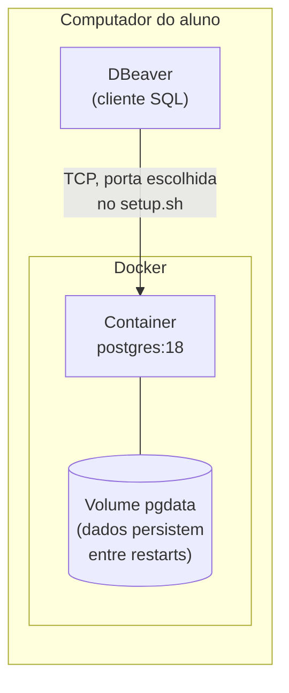
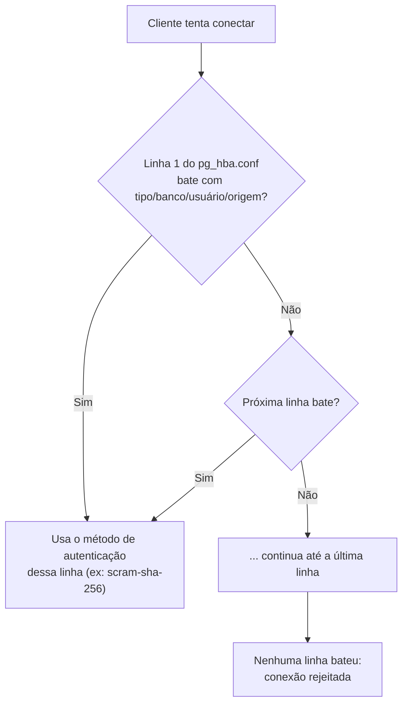
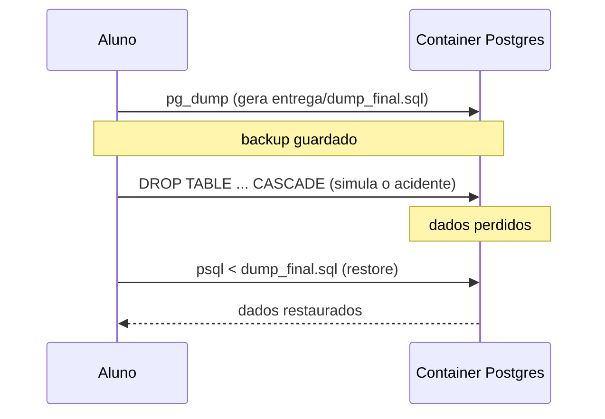

# Laboratório — Administração de PostgreSQL

## Visão geral e tempo estimado

| Etapa | Conceito | Tempo estimado |
|---|---|---|
| 1. Subir o ambiente | Containers como "VM leve" | 10 min |
| 2. Conectar via DBeaver | Arquitetura cliente-servidor | 10 min |
| 3. Parâmetros de configuração | Memória e conexões do servidor | 20 min |
| 4. Autenticação (`pg_hba.conf`) | Controle de acesso | 15 min |
| 5. Roles e privilégios | Princípio do menor privilégio | 15 min |
| 6. Backup lógico | `pg_dump` | 10 min |
| 7. Restore | Recuperação de desastre | 15 min |
| **Total** | | **~95 min** |

Turmas sem experiência prévia com Docker/DBeaver tendem a gastar uns 15-20 min extras
só nas etapas 1-2 (instalação, primeira conexão). Depois disso o ritmo acelera.

## Pré-requisitos
- Docker Desktop (ou Docker Engine + Compose) instalado e rodando.
- [DBeaver](https://dbeaver.io/) instalado (Community Edition é suficiente).

## Arquitetura do ambiente

Cada aluno sobe, na própria máquina, um container com PostgreSQL — nada é
compartilhado entre alunos nem depende de um servidor central. O DBeaver conversa
com esse container exatamente como conversaria com um servidor Postgres "de verdade"
em produção: por rede, numa porta TCP.



Por que isso importa: o que você aprende aqui sobre parâmetro, autenticação e
backup é o mesmo conceito de um Postgres rodando numa VM, num servidor bare-metal
ou num RDS da AWS — só a forma de acessar o arquivo de configuração muda (aqui é
`docker cp`/`docker exec`; numa VM seria SSH).

## 1. Subir o ambiente

```bash
./setup.sh
```

O script pergunta a porta (padrão `5433`, pra não conflitar com um Postgres que já exista
no seu computador na `5432`), usuário, senha e nome do banco. Ao final ele já sobe o
container e mostra os dados de conexão.

Pra parar: `docker compose stop`. Pra resetar tudo do zero (apaga os dados): `docker compose down -v`.

## 2. Conectar via DBeaver

**Conceito**: arquitetura cliente-servidor. O DBeaver é só um *cliente* — toda a
lógica (processar SQL, gerenciar memória, controlar acesso) roda do lado do
*servidor* (o container). É esse servidor que você vai administrar no resto do
laboratório.

Nova conexão → PostgreSQL → use os dados impressos pelo `setup.sh` (host `localhost`,
a porta que você escolheu, database, usuário e senha). Explore as tabelas `cliente`,
`produto` e `pedido` já carregadas.

## 3. Parâmetros de configuração

**Conceito**: o comportamento do servidor (quanta memória usar, quantas conexões
aceitar, o que registrar em log) é controlado por `postgresql.conf` — um arquivo de
texto simples, não um banco de configuração. Alguns dos parâmetros mais relevantes
pra administração:

| Parâmetro | O que controla |
|---|---|
| `max_connections` | Quantas conexões simultâneas o servidor aceita (cada uma consome memória e um processo) |
| `shared_buffers` | Memória reservada pro cache de páginas de dados — o parâmetro de performance mais citado do Postgres |
| `work_mem` | Memória que *cada operação* de ordenação/hash pode usar antes de gravar em disco temporário |
| `log_statement` | Quais comandos SQL vão pro log (útil pra auditoria e debug) |

No PostgreSQL 18 (mudou em relação a versões anteriores), o arquivo de configuração
roda dentro do container em `/var/lib/postgresql/18/docker/postgresql.conf`.

1. Copie o arquivo pra fora pra poder editar:
   ```bash
   docker cp lab_postgres:/var/lib/postgresql/18/docker/postgresql.conf entrega/postgresql.conf
   ```
2. Edite `entrega/postgresql.conf` e ajuste (pelo menos):
   - `max_connections`
   - `shared_buffers`
   - `work_mem`
   - `log_statement` (ex.: `'all'`, pra ver todo comando executado no log)
3. Copie de volta e reinicie pra aplicar:
   ```bash
   docker cp entrega/postgresql.conf lab_postgres:/var/lib/postgresql/18/docker/postgresql.conf
   docker compose restart db
   ```
4. Confirme a mudança no DBeaver ou via `psql`:
   ```sql
   SHOW max_connections;
   SHOW work_mem;
   ```

## 4. Autenticação (`pg_hba.conf`)

**Conceito**: o Postgres separa duas perguntas diferentes — "você tem permissão
pra fazer X?" (roles/privilégios, próxima etapa) e "você é mesmo quem diz ser?"
(autenticação, aqui). O `pg_hba.conf` é lido **linha por linha, de cima pra baixo**,
e a primeira linha que bater com tipo de conexão + banco + usuário + endereço de
origem decide o método de autenticação usado — as linhas depois dela nem são olhadas.



Mesma mecânica do passo anterior, com `pg_hba.conf`:

```bash
docker cp lab_postgres:/var/lib/postgresql/18/docker/pg_hba.conf entrega/pg_hba.conf
```

Ajuste a regra de autenticação pra exigir `scram-sha-256` (em vez de `trust`/`md5`) e
copie de volta + `docker compose restart db`. Teste reconectando no DBeaver.

## 5. Roles e privilégios

**Conceito**: depois que o Postgres confirma *quem* você é, ele decide *o que* você
pode fazer — isso é controlado por roles e `GRANT`/`REVOKE`. A boa prática de
administração é o **princípio do menor privilégio**: toda role deve ter só o acesso
estritamente necessário pra sua função, nunca mais.

Via DBeaver (SQL Editor) ou `psql`:

```sql
CREATE ROLE leitor LOGIN PASSWORD 'leitor123';
GRANT SELECT ON produto, cliente TO leitor;
```

Conecte uma nova conexão no DBeaver com o usuário `leitor` e confirme que:
- consegue fazer `SELECT` em `produto`;
- **não** consegue fazer `INSERT`/`UPDATE`/`DELETE`.

## 6. Backup lógico

**Conceito**: `pg_dump` gera um **backup lógico** — um arquivo com os comandos SQL
(`CREATE TABLE`, `INSERT`...) necessários pra recriar os dados do zero. É diferente
de um backup físico (cópia dos arquivos de disco do Postgres), que é mais rápido
pra restaurar mas não portável entre versões/arquiteturas diferentes. Pra laboratório
e pra a maioria dos cenários de PME, o backup lógico é suficiente e mais simples de
entender.

```bash
docker compose exec db pg_dump -U aluno -d loja -F p > entrega/dump_final.sql
```

(ajuste usuário/banco se tiver mudado no `setup.sh`).

## 7. Restore (simulando perda de dados)

**Conceito**: um plano de backup só vale alguma coisa se o restore funciona — por
isso essa etapa simula o cenário mais comum de desastre em produção: alguém
derrubou a tabela errada.



1. Simule um "acidente" apagando as tabelas (sem destruir o container/volume —
   **não** use `docker compose down -v` aqui, porque isso dispara de novo o
   `seed/init.sql` e colide com o restore do dump):
   ```sql
   DROP TABLE pedido, produto, cliente CASCADE;
   ```
2. Restaure a partir do dump:
   ```bash
   docker compose exec -T db psql -U aluno -d loja < entrega/dump_final.sql
   ```
3. Confirme no DBeaver que os dados voltaram.

## Entrega

Envie pelo Moodle:
- `entrega/postgresql.conf`
- `entrega/pg_hba.conf`
- `entrega/dump_final.sql`
- a saída do `check_lab.py` (rode `python check_lab.py` e anexe o resultado)
